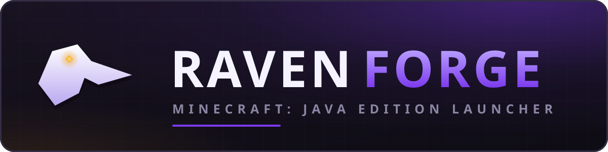
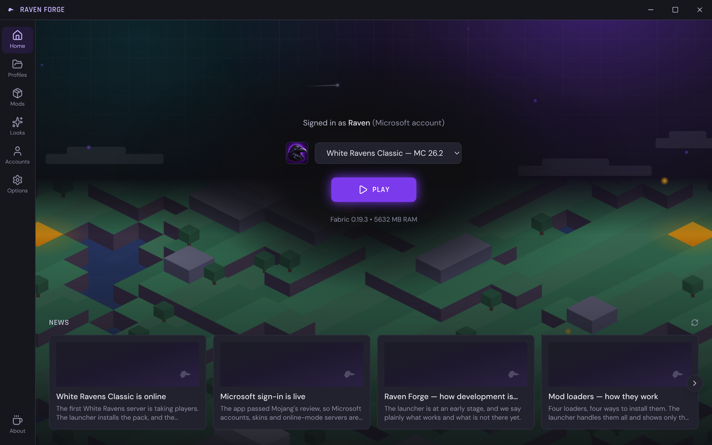
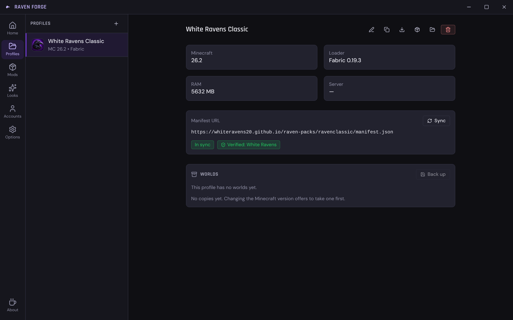
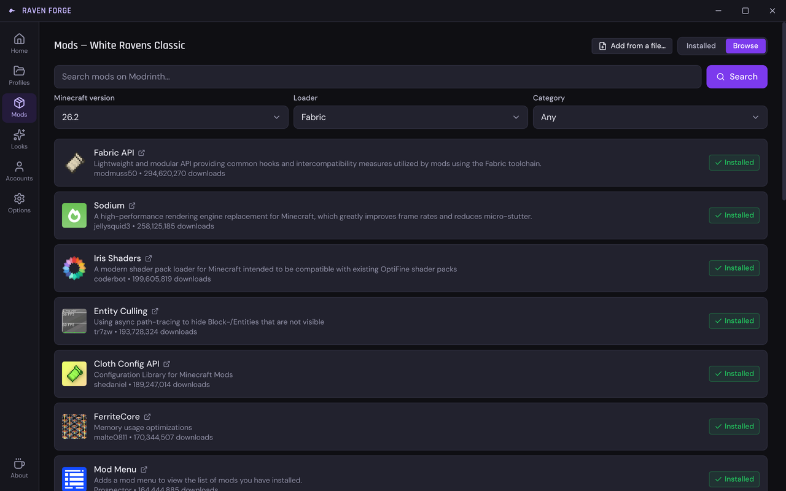

<div align="center">
    
<br /><br />

# Raven Forge

Minecraft: Java Edition launcher for modded players and server communities: signed packs that stay in sync, and no telemetry.

<br />

[](https://github.com/whiteravens20/raven-forge/releases/latest)
[](https://github.com/whiteravens20/raven-forge/actions/workflows/build.yml)
[](https://github.com/whiteravens20/raven-forge/actions/workflows/package.yml)
[](https://github.com/whiteravens20/raven-forge/actions/workflows/release.yml)
[](https://github.com/whiteravens20/raven-forge/actions/workflows/codeql.yml)
[](https://github.com/whiteravens20/raven-forge/actions/workflows/security.yml)
[](https://scorecard.dev/viewer/?uri=github.com/whiteravens20/raven-forge)
[](LICENSE)

<br />


</div>



**Why this exists:** Raven Forge was built for a modded server and the players on it. A player installs the server's pack once; from then on the launcher follows the manifest the server publishes, so every sync brings what changed, each file held to its hash and the manifest to its signature. Everything else a modded player expects is here too, from a Modrinth search to world backups, and nothing about you is measured or reported back.

> **🧪 TESTING & DEVELOPMENT — Raven Forge is usable today, but it is still in testing and active development. Some features are still landing, a few edges are rough, and details may change between releases. Bug reports, feedback and contributions are very welcome!**

NOT AN OFFICIAL MINECRAFT PRODUCT. NOT APPROVED BY OR ASSOCIATED WITH MOJANG OR MICROSOFT.

---

## Try It Now

Download the file for your system from the [latest release](https://github.com/whiteravens20/raven-forge/releases/latest):

| System                               | File                                       | Then                                                                                                                               |
| ------------------------------------ | ------------------------------------------ | ---------------------------------------------------------------------------------------------------------------------------------- |
| Windows 11 or 10 (1809+), x64        | `Raven-Forge-Launcher-Setup-<version>.exe` | Run it. It asks for no administrator rights. The installer is unsigned, so SmartScreen warns first: **More info**, **Run anyway**. |
| Debian 12+ or Ubuntu 22.04+, x64     | `raven-forge-launcher_<version>_amd64.deb` | `sudo apt install ./raven-forge-launcher_<version>_amd64.deb`                                                                      |
| Any other x64 Linux with glibc 2.25+ | `Raven-Forge-Launcher-<version>.AppImage`  | Make it executable and run it. It needs a few system libraries: [docs/INSTALL.md](docs/INSTALL.md#appimage).                       |

The window opens in your system's language if that is Polish, and in English otherwise; **Options → Appearance → Language** (**Ustawienia → Wygląd → Język**) changes it. Then:

1. **Accounts → Sign in with Microsoft.** You type your password on Microsoft's own page, never in the launcher.
2. **Profiles → New profile**, and say where it comes from: a White Ravens pack, a modpack found on Modrinth, a `.mrpack` file or a link, or an empty profile of your own.
3. **Home → PLAY.** The first start fetches what the profile still needs: Java, Minecraft and the loader.

## What It Does

- **Server packs that stay in sync** — a profile follows a manifest the server publishes; Sync or Play brings what changed, checked against its signature and hashes
- **Modrinth built in** — mods, shaders, resource packs and whole modpacks, searched from the launcher and filtered to your profile, with what they require and their updates handled
- **Loaders and Java handled** — Fabric, Quilt, Forge and NeoForge from the first Minecraft version they can be installed for, only the builds that start that version, and the Java it asks for
- **Packs in and out** — `.mrpack` files and links come in, a profile goes back out as a `.mrpack`
- **Worlds kept safe** — backups you can restore, and a question before a Minecraft version change touches them
- **Your disk, your choice** — move the data to another drive with a verified copy, and see every place the launcher writes to, with its size
- **Your sign-in kept out of the launcher's files** — you type your password on Microsoft's own page, and the tokens go into the system's credential store
- **It says what went wrong** — crash reports with tokens and account details stripped out, and errors that name the cause
- **No telemetry** — nothing is measured and nothing is reported back; the app lists what it stores and every server it contacts ([privacy policy](docs/PRIVACY.md))
- **Polish and English, three themes**, animated voxel scenes and a news feed

<p align="center">
  
  
</p>

The whole list is in [docs/FEATURES.md](docs/FEATURES.md).

## How It Works

The launcher is a desktop app in two parts. The window is a sandboxed page that holds no secrets: it asks the main process for everything over a typed set of channels, and whatever touches the disk, your account or a download happens there. Each profile is a folder of its own, while Minecraft's files, the loaders and the Java runtimes are downloaded once and shared.

A profile can follow a manifest, a file a server publishes at an address that names the Minecraft version, the loader and every mod with its hash. At every Sync and every Play the launcher reads it, checks its Ed25519 signature, compares it with what is installed, downloads what changed and refuses any file whose hash does not match. White Ravens' own key is compiled into the launcher, and a pack of ours that fails the check is refused. Any other signature is reported until you add a key of your own, and enforced from then on. A `.mrpack` is turned into the same kind of list and goes the same way, once.

You sign in on Microsoft's page, in a window of its own. The tokens that come back go into the system's credential store, or, where there is none, into a file only your user can read, and the Accounts page says so. The game then runs as its own Java process, and its session token is taken out of everything the launcher logs.

[docs/ARCHITECTURE.md](docs/ARCHITECTURE.md) goes through all of it.

## Documentation

| Document                                                                | What it covers                                                                               |
| ----------------------------------------------------------------------- | -------------------------------------------------------------------------------------------- |
| [docs/INSTALL.md](docs/INSTALL.md)                                      | What each file runs on and needs, updating, and checking what you downloaded                 |
| [docs/UNINSTALL.md](docs/UNINSTALL.md)                                  | Removing the launcher on each platform, and what happens to your profiles and worlds         |
| [docs/FEATURES.md](docs/FEATURES.md)                                    | Everything the launcher does                                                                 |
| [docs/PACKS.md](docs/PACKS.md)                                          | Where mods and packs come from, the formats it reads, and why not CurseForge                 |
| [docs/MANIFEST-SCHEMA.md](docs/MANIFEST-SCHEMA.md)                      | The manifest a server publishes                                                              |
| [docs/SIGNING.md](docs/SIGNING.md)                                      | Signing a manifest, and signing the installer                                                |
| [docs/CONFIGURATION.md](docs/CONFIGURATION.md)                          | The news and announcement feeds, the addresses White Ravens publishes, forking               |
| [docs/PRIVACY.md](docs/PRIVACY.md) · [🇵🇱 po polsku](docs/PRIVACY.pl.md) | Every byte stored and every server contacted, and why. Also in the app under About → Privacy |
| [docs/ARCHITECTURE.md](docs/ARCHITECTURE.md)                            | How it is built                                                                              |
| [docs/BUILDING.md](docs/BUILDING.md)                                    | The npm scripts and building the installers                                                  |
| [docs/AZURE-SETUP.md](docs/AZURE-SETUP.md)                              | Registering the Azure application behind Microsoft sign-in, for a fork                       |
| [docs/DISCORD-SETUP.md](docs/DISCORD-SETUP.md)                          | Registering the Discord application behind the optional status                               |

## Development

Node.js 24 or newer, npm 11 or newer, and a C++ toolchain for the one native module:

```bash
git clone https://github.com/whiteravens20/raven-forge.git
cd raven-forge
npm install
npm run dev
```

[CONTRIBUTING.md](CONTRIBUTING.md#development-setup) has what each platform needs, and [docs/BUILDING.md](docs/BUILDING.md) the rest of the scripts and how to build the installers.

## Contributing

Contributions are welcome: bug fixes, macOS support, accessibility and translations. Please read [CONTRIBUTING.md](CONTRIBUTING.md) before opening a pull request, against `dev` and never `main`.

## Code of Conduct

This project follows the [Contributor Covenant](CODE_OF_CONDUCT.md). By participating, you are expected to uphold this code.

## Security

Found a vulnerability? Do not open a public issue — use [private vulnerability reporting](https://github.com/whiteravens20/raven-forge/security/advisories/new), and redact access tokens from any log you attach. [SECURITY.md](SECURITY.md) says what to include and how soon to expect an answer, and describes the security model and its known gaps.

## How the code is written and checked

Raven Forge is built using AI coding tools. The maintainer decides what gets built and is responsible for everything that lands here. The launcher is still in testing, and before a release is published a group of human testers tries the release candidate at the maintainer's request.

**What a change goes through**

- Every push and pull request runs lint, type checking, a format check and the test suite — the tests on Linux and on Windows — then builds the launcher for both ([build.yml](.github/workflows/build.yml)). The parts where a mistake does real damage have tests of their own: the launch path, the hash check on downloads, manifest signature verification and the token store.
- CodeQL, `npm audit`, package signature checks and a Trivy scan for secrets and misconfiguration run on every push and pull request, and again every week ([codeql.yml](.github/workflows/codeql.yml), [security.yml](.github/workflows/security.yml)).
- Commits are signed, and the [OpenSSF Scorecard](https://scorecard.dev/viewer/?uri=github.com/whiteravens20/raven-forge) results are public.

**What the maintainer decided and read**

- The architecture was decided by the maintainer: the stack, the IPC protocol between the window and the main process, and the sign-in chain.
- White Ravens' own signing key is compiled into the launcher rather than fetched from where the manifests are, so a pack published by White Ravens is checked against a key that cannot be swapped along with the manifest ([docs/SIGNING.md](docs/SIGNING.md)).
- Generated code is reviewed and tested by the maintainer in the session that produces it. Changes to the sign-in chain and the token store, manifest signature verification, the hash check on downloads and the launch path are read line by line.

If something looks wrong, open an issue. For a vulnerability, use [private vulnerability reporting](https://github.com/whiteravens20/raven-forge/security/advisories/new).

## License

[GNU Affero General Public License, version 3](LICENSE) (AGPL-3.0-only), with one additional term in [NOTICE](NOTICE).

You are free to use, modify, and share this software. Anyone who distributes it, or a version based on it, has to do so under the same licence with the source code available, and has to keep the attribution "Raven Forge by White Ravens" together with the address of this repository.

NOT AN OFFICIAL MINECRAFT PRODUCT. NOT APPROVED BY OR ASSOCIATED WITH MOJANG OR MICROSOFT.
